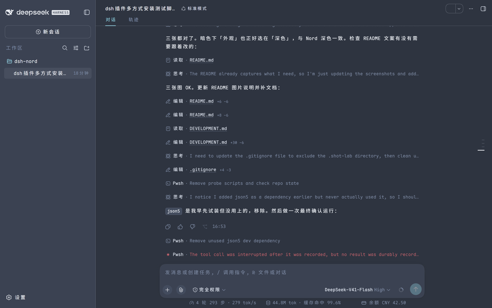
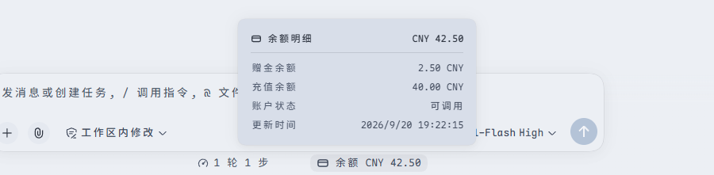
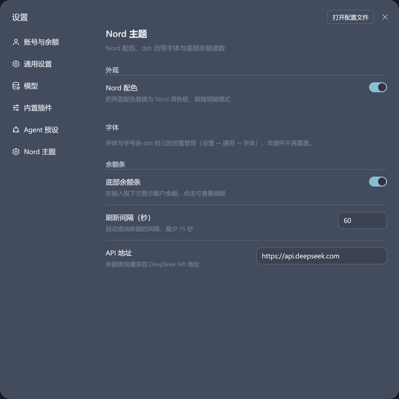

# dsh-nord

**中文** | [English](https://github.com/verdana/dsh-nord/blob/main/README.en.md)

给 [dsh](https://github.com/deepseek-ai/deepseek-harness) Web GUI 换一套 Nord：Nord 配色、一页自己的设置，以及 composer 下方的 DeepSeek 余额读数。dsh **0.2.1** 起字体与字号由 dsh 自己管理，0.1.7 / 0.2.0 上本插件仍提供字体替换。



## 功能

- **Nord 配色** —— 120 个设计 token（85 个语义 alias、10 个具名表面、25 个静态色阶补丁），浅色与深色两套，跟随 dsh 的「外观」设置切换；不写死颜色、不改 DOM，卸载即还原。
- **字体可选** —— 界面字体与代码字体分开选：跟随系统、八个预设（Maple Mono、JetBrains Mono、Cascadia Code、Fira Code、更纱黑体、霞鹜文楷、HarmonyOS Sans、MiSans），或者自己填一条 CSS `font-family`。预设是一整条回退栈，没装的家族自动落到下一个，中文回退由插件补在后面；下拉里的每一行用它自己的字体渲染，所以挑之前就能看到实际效果。界面字号仍跟随 dsh 的「字号大小」设置派生。

  > dsh **0.2.1** 起自带字体与字号设置（设置 → 通用 → 字体），本插件随之让位：不再注入任何字体样式表，设置页的字体组只留一行说明。更早的支持版本（0.1.7 / 0.2.0）仍由本插件提供字体替换。
- **余额读数** —— composer 下方，与官方的轮次/步骤统计在同一行。点击弹出明细面板。用 DeepSeek 模型时（或余额接口就是 DeepSeek 时），面板底部多一行「用量信息」，直达 [platform.deepseek.com/usage](https://platform.deepseek.com/usage)；其他供应商的面板保持原样。

  

- **独立的设置页** —— 设置面板左栏多一项「Nord 主题」，排在官方分区之后；本插件不再往「通用」里塞行。页面分外观、字体、余额条三组；dsh 0.2.1 起字体组改为一行委托说明（字体由 dsh 自己的设置管理）。

  

> 截图是深色下的样子（浅色由同一套 token 的另一半驱动）。三张图由 `node scripts/shots/capture.mjs` 在隔离实例里重拍，见 [DEVELOPMENT.md](DEVELOPMENT.md#截图怎么来的)。设置页那张是 dsh 0.2.1 上的样子：字体组只留一行委托说明。

- **宽表格不再抖动** —— 修掉 dsh 上游的一处布局问题：鼠标停在 markdown 宽表格底边时，表格会因为悬停预留高度来回切换而抖动。补丁把 `md-table-wide` 钉在普通 `overflow-x: auto`，不写 DOM、卸载即还原；代价是横向放不下的宽表格会常驻显示横向滚动条（放得下的宽表格照旧没有滚动条）。详见 [DEVELOPMENT.md](DEVELOPMENT.md#宽表格为什么被钉在-auto)。

## 环境要求

- dsh **`0.2.1-rc.2`** —— 构建基线，实机实测；**`0.2.0-rc.2`** 与 **`0.1.7-rc.2`** 同样支持并各自实测过。
- 余额读数需要 `DEEPSEEK_API_KEY`（由 dsh 的 credentials 服务解析）。没有凭据时余额条显示错误文案，主题、字体、设置不受影响。

### 兼容性

| dsh | 状态 | 字体 |
|---|---|---|
| `0.2.1` | 构建基线，实测 | 字体与字号由 dsh 自己的设置管理；插件不注入任何字体 |
| `0.2.0` | 实测 | 插件提供字体替换（界面 / 代码字体可选） |
| `0.1.7` | 实测 | 同上 |
| `0.1.5` 及更早 | **0.4.0 起不再支持** | — |

0.4.0 移除了 0.1.5 一代的兼容代码：那一代的设置命名空间是另一套接口（Host `installSection` + 浏览器 `settingsScope`），代码为此维护两份 schema 与双份设置传输。仍在 0.1.5 上的用户请留在 0.3.x。更完整的版本记录见 [DEVELOPMENT.md](DEVELOPMENT.md#版本现实)。

## 安装

从 npm：

```sh
dsh plugin --profile web add dsh-nord@^0.4.0
dsh web
```

版本写成 `^0.4.0` 这样的范围，而不是让 pnpm 去解 `latest` 标签。原因是 pnpm 11 起默认有 24 小时的「新版本冷静期」：某个版本发布不满一天时，`@latest` 解析不到它，会静默装回上一个版本（刚发版后想立刻验证时很容易踩到）。要装某个确切版本就直接写全，例如 `dsh-nord@0.4.0`。

从本仓库源码：

```sh
npm install && npm run build
dsh plugin --profile web add .
dsh --profile web --dump-config   # 应出现 "# == dsh-nord"
dsh web
```

从 GitHub 直接装：

```sh
dsh plugin --profile web add github:verdana/dsh-nord#main
```

`#main` 取的是分支最新提交；想锁死到某次提交，把 `main` 换成 commit sha 即可。

git 安装需要你在 profile 的 `pnpm-workspace.yaml` 里为该包授权构建脚本（`allowBuilds`），dsh 首次失败时会提示要粘贴的确切内容——这项授权等于允许该包在安装期执行代码，只对可信源码开放。不想让用户做这步，就用上面的 npm 或本地路径安装。

卸载：`dsh plugin --profile web remove dsh-nord`。

### 升级

0.4.0 收窄了支持范围、也改变了字体的接管方式，升级时先移除再装（0.2.1 起 HMR 装载的 profile 不接受对已安装包直接 `add`）：

```sh
dsh plugin --profile web remove dsh-nord
dsh plugin --profile web add dsh-nord@^0.4.0
```

装好后打开设置确认「Nord 主题」那一页还在：0.2.1 上字体组只剩一行说明，字体改在设置 → 通用 → 字体里选；0.2.0 / 0.1.7 上仍是插件自己的字体菜单，原有选择会沿用。

## 设置

设置面板 → 左栏「Nord 主题」（排在通用设置、模型、内置插件、Agent 预设之后）：

| 字段 | 默认 | 说明 |
|---|---|---|
| `themeEnabled` | true | 叠加 Nord 配色 |
| `fontEnabled` | true | 替换字体栈；关掉即回到 dsh 自带字体 |
| `uiFont` | `maple` | 界面字体：预设 id、`system`（跟随系统）或 `custom` |
| `uiFontCustom` | 空 | `uiFont: custom` 时使用的 CSS `font-family` 列表 |
| `codeFont` | `maple` | 代码字体：预设 id、`system`、`inherit`（跟随界面）或 `custom` |
| `codeFontCustom` | 空 | `codeFont: custom` 时使用的 CSS `font-family` 列表 |
| `balanceEnabled` | true | 显示底部余额条 |
| `refreshSeconds` | 60 | 余额刷新间隔，15–3600 |
| `baseURL` | `https://api.deepseek.com` | 余额接口地址 |

预设 id：`maple`、`jetbrains`、`cascadia`、`fira`、`sarasa`、`lxgw`、`harmony`、`misans`。

> `fontEnabled` / `uiFont` / `uiFontCustom` / `codeFont` / `codeFontCustom` 只在 dsh **< 0.2.1** 生效。0.2.1 起字体与字号由 dsh 自己的设置（设置 → 通用 → 字体）管理，本插件不注入任何字体 token；这些字段保留，是为了旧文档仍能解析、降级回旧版本时原来的选择还在。

也可以在 profile 的 `cordis.patch.yml` 里按 `id: dsh-nord` 覆盖。patch 会**整体替换**目标行的 `config`，所以要重述所有键（缺的键由 schema 默认值补上，所以旧 patch 仍然能启动）：

```yaml
- id: dsh-nord
  config:
    themeEnabled: true
    fontEnabled: true
    uiFont: maple
    uiFontCustom: ''
    codeFont: inherit
    codeFontCustom: ''
    balanceEnabled: true
    refreshSeconds: 60
    baseURL: https://api.deepseek.com
```

`uiFontCustom` / `codeFontCustom` 按 CSS `font-family` 语法写，逗号分隔，例如 `'LXGW WenKai', 'Microsoft YaHei'`。插件只保留能识别的家族名（分号、花括号、引号、括号等一律丢弃），再用引号重新拼好，并在末尾补上中文回退；`sans-serif` 这类通用族保持不加引号。

## 许可

[MIT](LICENSE)
